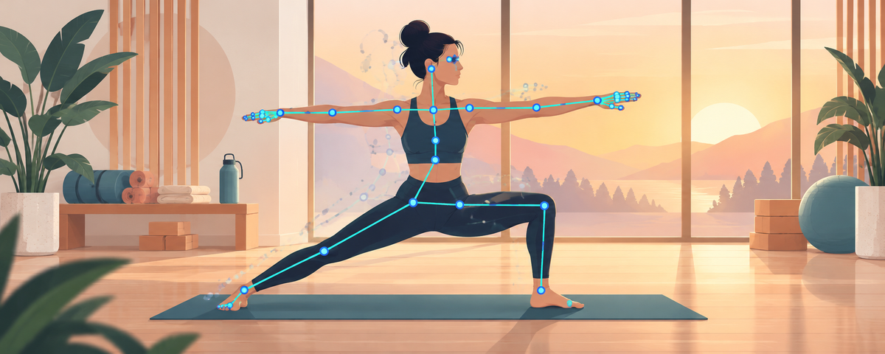

# BlazePose GHUM Heavy 3D

## Overview

BlazePose GHUM Heavy 3D is the MediaPipe pose landmark network used by the
multi-stream BlazePose 3D example in sima-neat/apps. It is the landmark stage
only: your application detects a person, crops a square pose region around
them, and passes that crop to the model. The model returns image-space
landmarks, a pose-presence score, and world-space 3D landmarks for one person.

## Inputs and outputs

**Input.** `input_1` is one RGB crop resized to 256×256 with bilinear
resampling and scaled to 0–1, passed as a 1×256×256×3 (NHWC) float tensor.

**Outputs.**

1. `Identity [1,195]`: 39 image-space records of x, y, z, visibility logit,
   and presence logit.
2. `Identity_1 [1,1]`: global pose-presence logit.
3. `Identity_4 [1,117]`: 39 world-space x, y, z records.

Apply a sigmoid to the visibility and presence logits; the model leaves them
raw. The first 33 records of each landmark tensor are the public BlazePose body
landmarks. MediaPipe uses only `Identity` records 33 and 34 as auxiliary
landmarks for deriving the crop for the next frame; records 35–38 are not part
of its postprocessed landmark outputs. MediaPipe likewise discards `Identity_4`
records 33–38. Ignore those trailing records.

`Identity` x and y are pixel positions in the 256×256 crop. For an
axis-aligned square crop of side `s` at `(left, top)`, the source position is
`left + x * s / 256` and `top + y * s / 256`; also remove any padding and
rotation you applied. z is relative depth on roughly the scale of x, with the
hip midpoint near zero, not metres. `Identity_4` x, y, and z are in metres
around the hip midpoint and are not projected through the crop; rotate them by
any crop rotation to return to camera orientation. These steps follow
MediaPipe's
[pose postprocessing graph](https://github.com/google-ai-edge/mediapipe/blob/master/mediapipe/modules/pose_landmark/tensors_to_pose_landmarks_and_segmentation.pbtxt).

## Building applications

Run the package with the [Neat Model
API](https://developer.sima.ai/software/develop-apps/development-workflow/model).
For complete applications, start from the [Neat example
apps](https://developer.sima.ai/examples).
