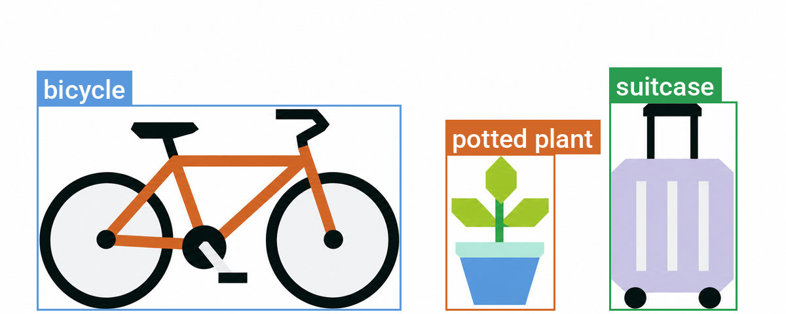

# D-FINE Nano

## Overview

D-FINE Nano is a compact transformer object detector trained to find the 80
COCO object classes in ordinary images. It runs as two components: a backbone
that extracts features and proposes candidate locations, and a decoder that
refines the best 300 candidates into boxes and class scores. Your application
selects the candidates on the CPU between the components while retaining the
original feature tensor. Native preprocessing accepts RGB images at their
original size, and native decoding can return boxes in those original image
coordinates without additional overlap suppression.

## Inputs and outputs

**Input.** Stretch the RGB image to 640×640 with bilinear resampling, without
preserving aspect ratio. Scale pixel values to 0–1; do not apply ImageNet mean
or standard deviation. The scripts let Neat perform these steps on the original
image and retain its dimensions for decoding.

**Between components.** The backbone returns `attention_memory` and
`query_content`, each shaped (1, 2000, 128), `proposal_scores` (1, 2000), and
`reference_logits` (1, 2000, 4). Select the 300 highest proposal scores, breaking
ties by lower proposal index. Gather the corresponding content and raw reference
rows. Pass the original attention tensor and those two gathered tensors to the
decoder; keep their storage alive until execution completes.

**Outputs.** The decoder returns `pred_boxes` (1, 300, 4), normalized
(cx, cy, width, height), and `pred_logits` (1, 300, 80).

1. Apply sigmoid to the class logits and rank all 300 × 80 box-class pairs.
2. Keep the 300 best pairs, including different classes from the same box; do not apply overlap suppression.
3. Convert boxes to corners, scale by the original image dimensions, and clip to that image.
4. Map each class index through the sorted list of the 80 COCO category IDs, which contains gaps.

Neat's `DetrFocal` BoxDecode performs this decoding and publishes integer boxes
with rounded origins and sizes. It is distinct from classic `Detr` decoding.

## Building applications

Run the package with the [Neat Model
API](https://developer.sima.ai/software/develop-apps/development-workflow/model).
For complete applications, start from the [Neat example
apps](https://developer.sima.ai/examples).
