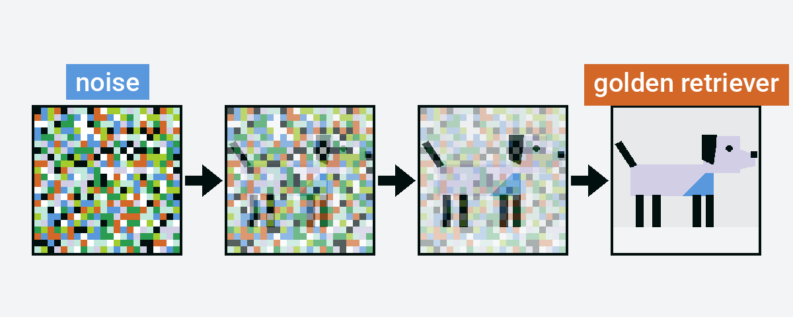

# DiT-XL/2 256

## Overview

DiT-XL/2 256 generates a 256 x 256 image of one of the 1000 ImageNet classes.
It starts from random noise and removes a little of it per step: the
transformer component predicts the noise in a 4 x 32 x 32 latent for the
requested class and for no class at once, and your application combines the
two and steps the latent. After the last step, the VAE decoder component turns
the latent into the image.

## Inputs and outputs

**Start.** Draw a [1, 4, 32, 32] latent from a standard normal distribution.
Choose the DDIM timesteps, for example 50 evenly spaced from 999 to 0, and a
guidance scale, such as 4.

**Each step.** For timestep t:

1. `transformer_timestep_features` [2, 256, 1, 1]: for i < 128, cos(t · 10000^(−i/127)) at i and sin of the same at 128 + i; the same in both rows.
2. `transformer_class_one_hot` [2, 1001, 1, 1]: 1 at the class in row 0 and at 1000, the null class, in row 1.
3. `transformer_latent` [2, 4, 32, 32]: the latent in both rows.
4. `transformer_prediction` [2, 8, 32, 32]: take channels 0-3 of each row; noise = row 1 + scale · (row 0 − row 1).
5. Take the DDIM step from t to the next timestep with that noise.

**Decoding.** Pass the final latent to `vae_decoder_latent` [1, 4, 32, 32] as
it is; the component divides by 0.18215. `vae_decoder_image` [1, 3, 256, 256]
is RGB in [−1, 1]: map it to 8-bit with (x + 1) · 127.5, clipped to [0, 255].

## Building applications

Run the package with the [Neat Model API](https://developer.sima.ai/software/develop-apps/development-workflow/model). For complete applications, start from the [Neat example apps](https://developer.sima.ai/examples).
