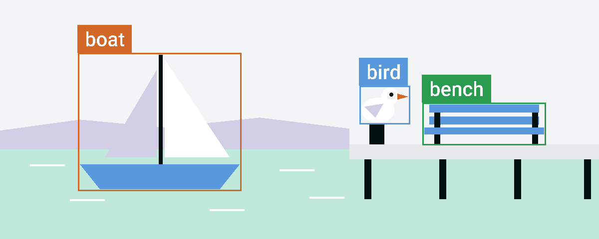

# Faster R-CNN ResNet-50 FPN v2

## Overview

Faster R-CNN ResNet-50 FPN v2 is torchvision's two-stage COCO object detector.
It takes an RGB image, resized into a 1344×1344 input, and returns up to 100
boxes with a class and score each. It runs as two components: the
backbone computes feature maps and proposes objects, the CPU pools 1,000
proposed regions, and the box head classifies each region and refines its box.

## Inputs and outputs

**Input.** Scale RGB to 0–1, subtract the mean (0.485, 0.456, 0.406) and divide by the standard deviation (0.229, 0.224, 0.225). Resize bilinearly, keeping the aspect ratio, to a short side of 800, long side at most 1333. Place it top-left in a zero 1344×1344×3 float tensor.

**Between the components.** The output `backbone` has one row per cell of maps P2 (336×336) to P6 (21×21), in order: 256 map values, three objectness scores (multiply by 16), and four box offsets per anchor (multiply by 2).

1. Per level, move the 1,000 best anchors by their offsets, clip to the resized image, and drop boxes overlapping a better one above 0.7 intersection over union (IoU).
2. Keep the 1,000 best boxes across levels.
3. Pool each box into 7×7 cells from the map its size selects.
4. Place region i at row i ÷ 40, column i mod 40 of a 25×40 grid of 8×8 cells, zero elsewhere: the 200×320×256 input `rois`.

**Outputs.** On the same grid, the box head returns `class_logits` (91 per region) and `box_regression` (4 per class).

1. Apply a softmax to each region's logits and keep region-class pairs above 0.05.
2. Divide the offsets by 10, 10, 5 and 5, move the region's center by the first two, and scale its size by the exponent of the last two.
3. Per class, drop overlaps above 0.5 IoU; keep the 100 best overall.
4. Divide by the resize scale for original-image coordinates.

Class index i is COCO category ID i: index 0 is the background, and 10 indexes are unused.

## Building applications

Run the package with the [Neat Model
API](https://developer.sima.ai/software/develop-apps/development-workflow/model).
For complete applications, start from the [Neat example
apps](https://developer.sima.ai/examples).
