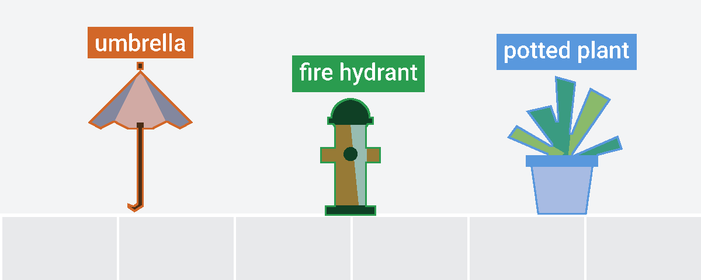

# Mask2Former Swin-T COCO

## Overview

Mask2Former finds every object of the 80 COCO classes in an image and returns
each one's class and pixel mask. It is a masked-attention transformer with a
Swin-T backbone: 100 learned queries each predict one object, attending only
inside the mask they predicted at the previous step. It takes a 384×384 RGB
image and runs as five components: the backbone as `backbone_0` and
`backbone_1`, the pixel decoder as `pixel_decoder_0` and `pixel_decoder_1`, and
the `transformer_decoder`. The CPU only prepares the image and decodes the
instances. Build: `w16a16` (BF16).

## Inputs and outputs

**`backbone_0` input.** `image`, 384×384 RGB. Stretch the image to 384×384 with
bilinear resampling, then normalize the 0–255 values with mean (123.675,
116.28, 103.53) and standard deviation (58.395, 57.12, 57.375).

**Between the components.** Each input is the earlier output of the same name,
unchanged: `backbone_0` returns `features0`, `features1` and `stage3_input`;
`backbone_1` takes `stage3_input` and returns `features2` and `features3`;
`pixel_decoder_0` takes `features1` to `features3` and returns `tokens`;
`pixel_decoder_1` takes `tokens` and `features0` and returns `mask_features`,
`scale0`, `scale1` and `scale2`, which the `transformer_decoder` takes.

**`transformer_decoder` outputs.**

- `class_logits`: for each of the 100 queries, logits over the 80 COCO classes and a final "no object" class, as 81 channels by 100 queries.
- `mask_logits`: for each query, mask logits on a 96×96 grid covering the input.

Decode the instances:

1. Apply a softmax over each query's 81 logits and drop "no object".
2. Keep the 100 highest (query, class) probabilities.
3. Upsample each kept query's mask bilinearly to 384×384, resize it to the image and threshold at 0.
4. Score each instance as its class probability times the mean sigmoid of its mask logits inside the mask.

Class index `i` is the `i`-th COCO category in increasing category ID order
(0 is person, 79 is toothbrush). `scripts/pipeline.py` implements these steps
with NumPy and Pillow.

## Building applications

Run the package with the [Neat Model
API](https://developer.sima.ai/software/develop-apps/development-workflow/model).
For complete applications, start from the [Neat example
apps](https://developer.sima.ai/examples).
