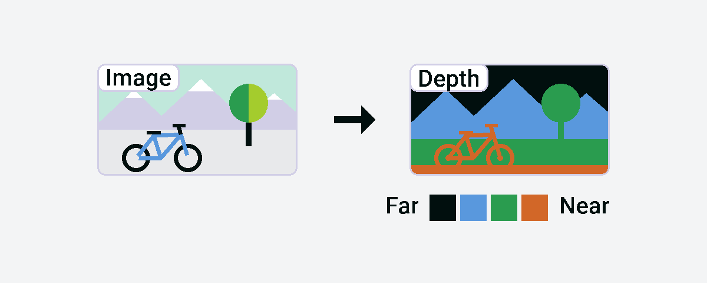

# MiDaS v2.1 Small

## Overview

MiDaS v2.1 Small estimates how far away every pixel of an image is. It pairs
an EfficientNet-Lite3 encoder with a light decoder that fuses four encoder
stages into one dense map. It takes a 256×256 RGB image and returns a 256×256
map of relative inverse depth, where larger values are closer. The values have
an unknown scale and offset, so your application aligns them to real distances
when it needs them. The model runs as one component.

## Inputs and outputs

**Input.** Scale the RGB values to 0–1, then resize the image to 256×256 with
bicubic resampling, without keeping its aspect ratio. Subtract the ImageNet
mean (0.485, 0.456, 0.406) and divide by the standard deviation (0.229, 0.224,
0.225). Neat's image preprocessing resizes bilinearly instead, which changes the
depth slightly, so for the reference resampling resize the image bicubically to
256×256 before passing it to Neat. The accuracy script passes this image as a
256×256×3 (height, width, channel) float tensor, with Neat's resize, color
conversion, and normalization turned off.

**Outputs.** `predicted_depth` holds 256×256 values of relative inverse depth.

1. Resize `predicted_depth` to your image's resolution with bicubic interpolation.
2. For a relative depth view, use the values directly: larger is closer.
3. For metric depth, fit a scale s and an offset t so that s × value + t matches 1 / distance at points of known distance, such as from a depth sensor.
4. Take each pixel's distance as 1 / (s × value + t), capped at the farthest distance your scene can contain.

No Neat decoder handles this output.

## Building applications

Run the package with the [Neat Model
API](https://developer.sima.ai/software/develop-apps/development-workflow/model).
For complete applications, start from the [Neat example
apps](https://developer.sima.ai/examples).
