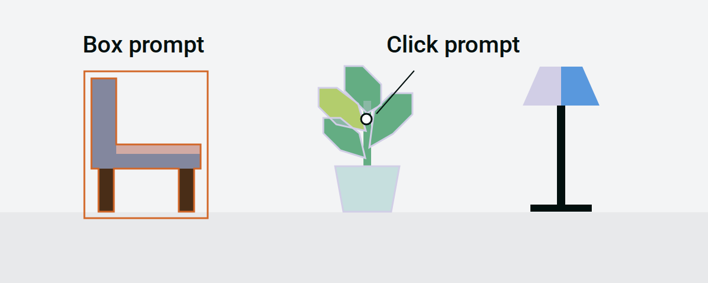

# MobileSAM

## Overview

MobileSAM turns clicks or boxes into object masks using a TinyViT image encoder distilled from Segment Anything. The package runs as three components: `image_encoder_0` and `image_encoder_1` prepare an image embedding, then `prompt_decoder` predicts masks for each prompt. Run both encoder components once per image and reuse the embedding for subsequent prompts. You supply foreground or background clicks, box corners, or a combination; mask prompts are not supported.

## Inputs and outputs

Prepare `image` as RGB: resize its longer side to 1024 with bilinear resampling, normalize 0–255 pixels using mean (123.675, 116.28, 103.53) and standard deviation (58.395, 57.12, 57.375), then zero-pad the right and bottom to 1024×1024.

1. Pass `image` to `image_encoder_0`. Feed its `features` output, 160 channels on a 64×64 grid, unchanged into `image_encoder_1`.
2. Keep the resulting `image_embeddings`, 256 channels on a 64×64 grid. Pass them to `prompt_decoder` for each prompt.
3. Prepare up to five points with `prompt_inputs` and `PromptEncoding` in `scripts/pipeline.py`. Load the package's `prompt-encoding.json` once. The CPU produces `point_encoding` with 256 float32 channels and six slots. `point_types` has five one-hot channels: padding, background, foreground, box top-left, box bottom-right. Point-only prompts include one padding token; unused slots are zero and excluded from attention.
4. Read `masks`, four 256×256 logit maps, and `iou_predictions`, their predicted quality. Choose mask 0 for boxes or several clicks; for one click, choose the highest-quality mask among 1–3. Upsample its logits to 1024×1024, remove padding, resize to the original image, then threshold at zero.

Masks carry no class labels. The helpers use NumPy, Linux libm, Pillow and OpenCV.

## Building applications

Run the package with the [Neat Model
API](https://developer.sima.ai/software/develop-apps/development-workflow/model).
For complete applications, start from the [Neat example
apps](https://developer.sima.ai/examples).
