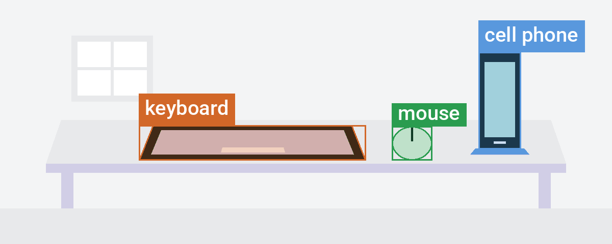

# RTMDet-Ins S

## Overview

RTMDet-Ins S is the small size of OpenMMLab's RTMDet-Ins instance segmenter,
trained on COCO. It finds objects in an image and returns a box, a class score,
and a pixel mask for each one. It runs as one component that predicts class
scores, boxes, and mask kernels at three scales, plus shared mask features.
Your application selects the detections and builds their masks on the CPU.

## Inputs and outputs

**Input.** Resize the image with bilinear resampling so it fits 640×640 while
keeping its aspect ratio. Pad it on the right and bottom to 640×640 with gray
(114, 114, 114). Subtract the ImageNet mean (123.675, 116.28, 103.53) from the RGB values and divide by the standard
deviation (58.395, 57.12, 57.375).

**Outputs.** Each tensor is in height, width, channel order, at stride 8, 16, or
32 (grids of 80, 40, and 20 cells):

- `cls_score_0` to `cls_score_2`: 80 class logits.
- `bbox_pred_0` to `bbox_pred_2`: distances in input pixels to the box's left, top, right, and bottom edges.
- `kernel_pred_0` to `kernel_pred_2`: 169 mask kernel parameters.
- `mask_feat`: 8 mask features on an 80×80 grid, at stride 8.

1. The cell in column c and row r at stride s sits at (c × s, r × s). Apply a sigmoid to the logits.
2. On each grid, keep the 1000 best cell-class pairs above 0.05.
3. Build each box from its cell and distances, clip it to the resized image, and divide by the resize scale.
4. Remove same-class boxes overlapping at IoU 0.6 and keep the best 100.
5. At each mask cell, stack the box cell's offset, divided by 8 times its stride, with the 8 mask features. Apply the box's kernel as three 1×1 layers (10, 8, 8, 1 channels; weights, then biases; ReLU between).
6. Upsample 8× bilinearly, resize to the image, and keep the pixels above zero.

Class index i is the i-th COCO category ID in ascending order.

## Building applications

Run the package with the [Neat Model API](https://developer.sima.ai/software/develop-apps/development-workflow/model). For complete applications, start from the [Neat example apps](https://developer.sima.ai/examples).
