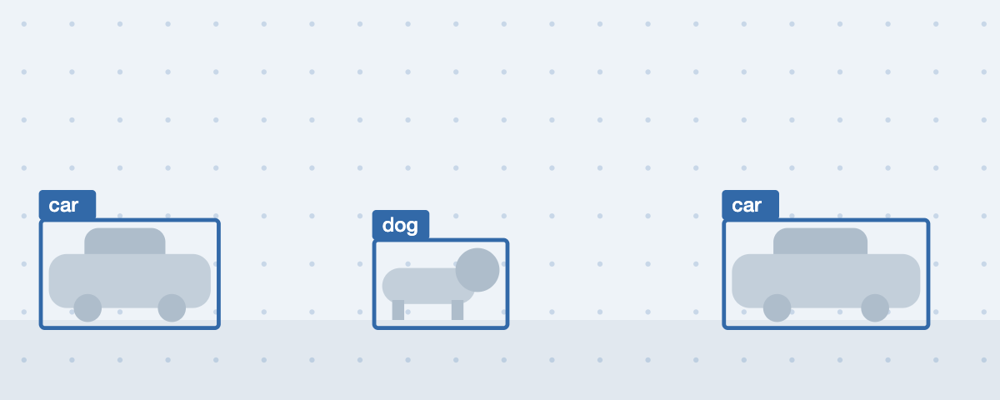

# SSD-MobileNet V1

## Overview

SSD-MobileNet V1 is a single-shot object detector (SSD) with a MobileNet V1
backbone, trained on COCO. It takes a 300×300 RGB image and returns raw box and
class predictions for 1,917 anchors over six grid levels. An anchor is a fixed
reference box that each prediction adjusts. Neat's SSD box decoder turns these
predictions into detections.

## Inputs and outputs

**Input.** Resize the image to 300×300 with bilinear resampling, without keeping
the aspect ratio. Scale the RGB values to -1 to 1: divide by 255, subtract 0.5,
and divide by 0.5.

**Outputs.** Twelve tensors over six levels, with grids of 19, 10, 5, 3, 2, and 1 cells and three anchors per cell at level 0 and six at the other levels:

- `ssd_loc_0` to `ssd_loc_5`: four box offsets (y, x, height, width) for each anchor.
- `ssd_confidence_0` to `ssd_confidence_5`: 91 class logits for each anchor.

Neat's `Ssd` box decoder is built for these outputs, but the current Neat runtime rejects them, so decode them in your application:

1. Generate the 1,917 anchors: per level, box scales from 0.2 to 0.95 with aspect ratios 1, 2, 0.5, 3 and 1/3, plus one extra square box; level 0 uses a 0.1 square box and the 2 and 0.5 boxes.
2. Divide the offsets by 10, 10, 5 and 5, then move each anchor's center by the first two and scale its height and width by the exponent of the last two.
3. Apply a sigmoid to the class logits.
4. Within each class, drop boxes that overlap a higher-scoring box by more than 0.6 intersection over union, and keep the 100 best detections overall.

Class index i is COCO category ID i: index 0 is the background, and 10 indexes are unused.

## Building applications

Run the package with the [Neat Model
API](https://developer.sima.ai/software/develop-apps/development-workflow/model).
For complete applications, start from the [Neat example
apps](https://developer.sima.ai/examples).
