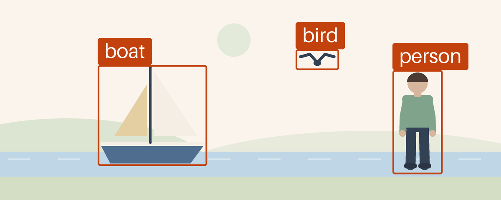

# SSD-MobileNet V3

## Overview

SSD-MobileNet V3 is a single-shot object detector with a MobileNet V3 Large
backbone, trained on COCO. It predicts objects from 3,234 reference boxes across
six grid levels. The w8a8 build has not passed its existing accuracy gate;
qualification is incomplete. It uses post-training quantization of the original
weights, not the historical quantization-aware-trained export.

## Inputs and outputs

**Input.** Pass the original RGB image to the Model API with image preprocessing,
stretch resizing and explicit mean and standard deviation of 0.5. Neat resizes
to 320×320; do not resize or normalize again in your application. The source
reference normalizes before half-pixel bilinear resizing without antialiasing.
The native path is not claimed to be bit-equivalent.

**Compiled outputs.** Twelve tensors over grids of 20, 10, 5, 3, 2 and 1 cells,
with six reference boxes per cell:

- `ssd_loc_0` to `ssd_loc_5`: box offsets (x, y, width, height).
- `ssd_confidence_0` to `ssd_confidence_5`: 91 class logits per reference box.

Set `ModelOptions.decode_type` to `BoxDecodeType.Ssd` for one typed bounding-box
output. `scripts/accuracy.py` measures original images with threshold 0.001,
IoU 0.55 and top 300.

Its independent reference functions use TorchVision anchors, offset scales
(10, 10, 5, 5), an exponential cap of log(1000/16), clipping and softmax including
background. They retain 300 candidates per class before overlap suppression,
then 300 overall. This is not a claim of native decoder equivalence.
Class index i is COCO category ID i; index 0 is background.

Performance remains undeclared. The standalone entry point produces no report
until whole-model measurements and accuracy qualification are complete. Its
prepared application policy is threshold 0.2, IoU 0.6 and top 100.

## Building applications

Run the package with the [Neat Model API](https://developer.sima.ai/software/develop-apps/development-workflow/model).
For complete applications, start from the [Neat example apps](https://developer.sima.ai/examples).
