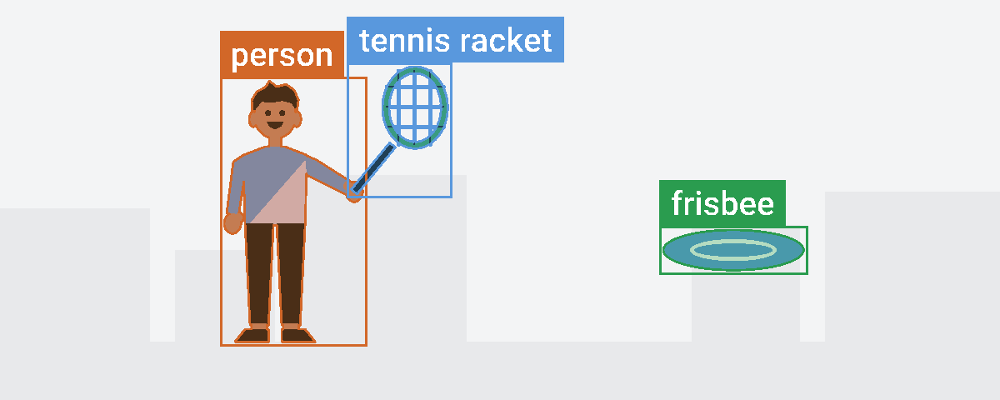

# YOLOv8x-seg

## Overview

YOLOv8x-seg is the Extra-Large size of the Ultralytics YOLOv8 instance segmentation
model, trained on the 80 COCO classes. For each object in a 640×640 RGB image,
it returns a box, a class, and a pixel mask mixed from 32 shared patterns
(prototypes). The application removes duplicate boxes with non-maximum suppression.

## Inputs and outputs

**Input.** Letterbox the image to 640×640: resize it with bilinear resampling so
its longer side is 640, center it, and fill the rest with gray (114, 114, 114).
Scale RGB values to 0–1. For tensor input, pass a 640×640×3 float32 tensor with
Neat's resize, color conversion, and normalization off; for image input, Neat
does these steps.

**Outputs.** Each tensor is in height, width, channel order, at stride 8, 16, or
32 (grids of 80, 40, and 20 cells):

- `bbox_0` to `bbox_2`: 16 bins per left, top, right, and bottom edge distance.
- `class_logit_0` to `class_logit_2`: 80 class logits.
- `mask_coeff_0` to `mask_coeff_2`: 32 mask coefficients.
- `mask_proto`: 32 prototypes on a 160×160 grid, at stride 4.

1. The cell in column c and row r has its center at (c + 0.5, r + 0.5).
2. Each edge distance in cells is the softmax-weighted mean of its 16 bin indices.
3. The box corners are the center minus the left and top distances and plus the right and bottom distances, times the stride.
4. Apply a sigmoid to the logits and keep the cell-class pairs above your score threshold.
5. Remove overlapping boxes of the same class with non-maximum suppression at an overlap threshold of 0.7.
6. Multiply `mask_proto` by each detection's coefficients and resize the result bilinearly to 640×640. Positive pixels inside the box belong to the object.
7. Remove the letterbox padding, divide by the letterbox scale, and clip to the image. Map the masks the same way.

Class index i is the i-th COCO category ID in ascending order. Neat's
`YoloV8Seg` box decoder can also decode these outputs.

## Building applications

Run the package with the [Neat Model API](https://developer.sima.ai/software/develop-apps/development-workflow/model). For complete applications, start from the [Neat example apps](https://developer.sima.ai/examples).
